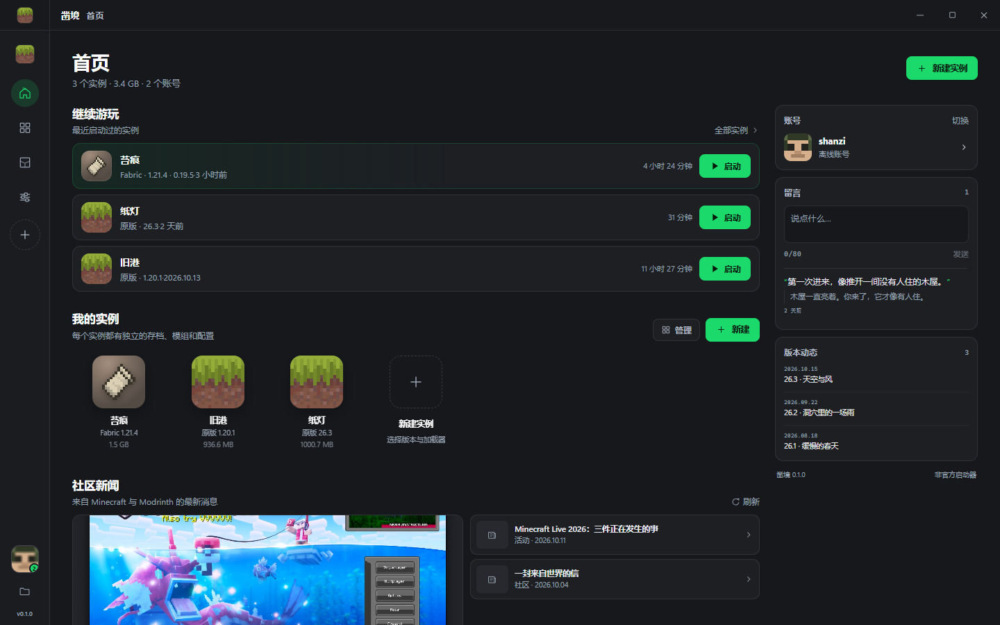
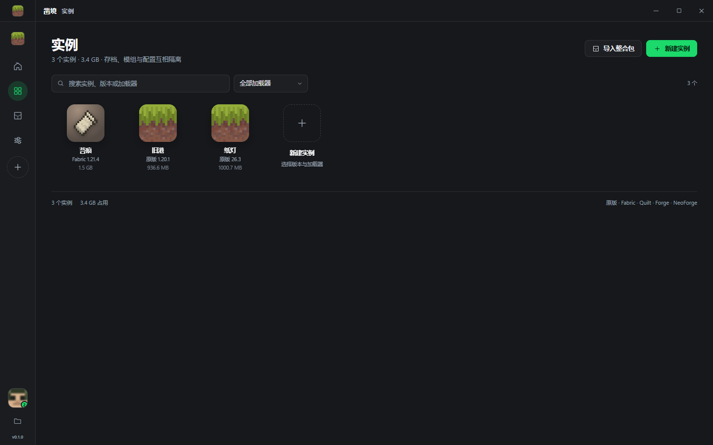
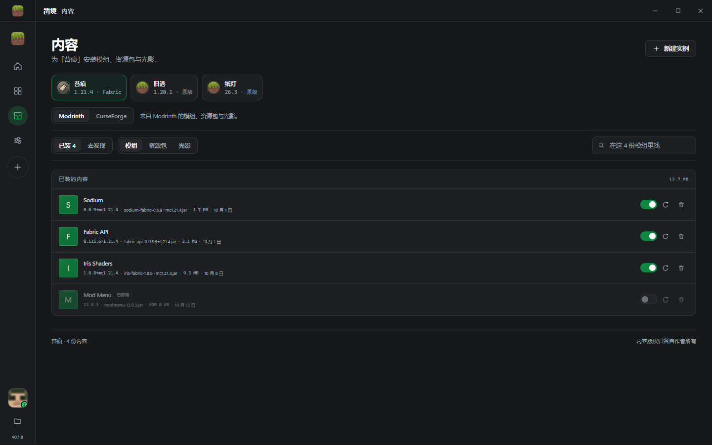

<h1 align="center">凿境 / CHISEL</h1>

<p align="center">
  Windows 上的 Minecraft Java 版启动器。<br>
  实例互相隔离，官方源与 BMCLAPI 镜像自适应，不打包任何游戏资源。
</p>

<p align="center">
  <a href="https://github.com/LORQAQ/chisel-launcher/releases"></a>
  <a href="https://github.com/LORQAQ/chisel-launcher"></a>
  <a href="LICENSE"></a>
  <a href="https://github.com/LORQAQ/chisel-launcher/stargazers"></a>
</p>

<p align="center">
  
</p>

---

## 为什么是它

用过的启动器大多有同样的毛病：所有实例共用一个 `.minecraft`，装一个模组就把别的存档搭进去；下载走不动只能干等；界面把功能埋在三层层级里。凿境按下面几条做：

- **一个实例一套目录。** 存档、模组、配置、崩溃报告全部落在 `instances/<id>/game`，删实例就是删这一个目录。版本 JSON、库和资源在 `shared/` 里共享，不重复占盘。
- **下载慢就先量一遍。** 启动器对 Mojang 官方源和 BMCLAPI 做延迟探测，10 分钟内复用结果；官方源不可达或者镜像在 1.25 倍延迟以内就走镜像。≥ 8 MB 的文件（客户端 jar、资产包）自动分片 Range 并发下载。
- **界面只有一条主路径。** 首页放"继续游玩"，实例页负责新建和导入，内容页负责模组/资源包/光影，设置页负责 Java 和下载。没有向导、没有引导气泡、没有弹窗广告位。

## 功能

| | |
| --- | --- |
| **加载器** | 原版、Fabric、Quilt、Forge、NeoForge、OptiFine |
| **整合包** | `.mrpack`（Modrinth）与 CurseForge `manifest.zip`，含 overrides 与 client-overrides |
| **内容安装** | Modrinth 搜索/安装/更新/启停；CurseForge 链接安装与整合包导入；Iris / OptiFine 光影一键准备 |
| **账号** | Microsoft 设备码登录（自动复制代码并打开带 `otc=` 的链接）、离线账号、authlib-injector 外置登录 |
| **Java** | 扫描 10+ 常见安装位置与注册表、其他启动器的内置运行时、Microsoft Store 包；按位数和主版本挑选，缺失时可后台下载 |
| **启动** | 完整规则求值的 JVM/游戏参数、PerMonitorV2 高 DPI、自定义分辨率、启动后关窗、日志面板与崩溃记录分析 |
| **实例管理** | 重命名、自定义图标（自动裁方并压到 256px）、打开目录、删除（送回收站，不直接抹掉） |

Forge / NeoForge 走官方安装器（`--installClient`），OptiFine 用嵌入的无头入口调用它自己的 `optifine.Installer.doInstall()`，三者生成的 profile 与库都会落到实例的加载器目录里，因此和手动安装的结果一致。

## 界面

<p align="center">
  
  
</p>

## 构建

需要 .NET 8 SDK、Node.js 18+，以及 Windows。界面是独立的前端，构建产物会被 .NET 项目当资源拷进去，所以顺序不能反。

```powershell
# 1. 界面
cd web
npm install
npm run build          # tsc --noEmit && vite build -> web/dist

# 2. 主程序
cd ..
dotnet build src/Chisel.App -c Release
# 产物：src/Chisel.App/bin/Release/net8.0-windows/Chisel.exe
```

只要一个自包含的单目录版本：

```powershell
dotnet publish src/Chisel.App -c Release -r win-x64 --self-contained -p:PublishSingleFile=true
```

开发时可以在浏览器里跑 `npm run dev`：`web/src/lib/mock.ts` 里有一层假桥接，没有 WebView2 也能点完整个界面。

## 数据在哪里

| 位置 | 内容 |
| --- | --- |
| `%APPDATA%\Chisel\` | 默认根目录 |
| `config.json` / `accounts.json` | 设置与账号 |
| `instances/<id>/game` | 该实例的存档、模组、日志 |
| `shared/` | 版本 JSON、libraries、assets（跨实例共享） |
| `java/` `cache/` `logs/` `temp/` | 运行时、缓存、日志、临时文件 |

放一个空的 `portable.txt` 在 `Chisel.exe` 旁边，或者带 `--portable` 启动，数据就全在程序目录的 `data/` 下。也可以用环境变量 `CHISEL_DATA_DIR` 指定任意目录。

## 隐私与安全

- 不打包、不分发任何 Mojang 游戏文件。第一次用时按官方 manifest 现场下载，逐个校验 SHA1 与大小。
- 账号令牌用 Windows DPAPI（当前用户）加密后存在本地，不写死在代码里，也不会上传到任何地方。凿境没有服务端，不收集任何遥测。
- 微软登录用自己的 Azure 客户端 ID（设置页可填），走设备码流程，密码只输入在微软的页面上。
- 下载域名收敛在白名单内：Mojang 官方、BMCLAPI、Modrinth CDN、CurseForge CDN、Forge/NeoForge Maven、authlib-injector 发布地址。
- WebView2 默认拒绝权限请求与自动下载；所有文件写入前做路径穿越检查，实例目录之外拒绝打开。
- 删除实例走 Windows 回收站。

## 项目结构

```
Chisel.sln
├── src/Chisel.App/      WinForms + WebView2 外壳、JS 桥接（Bridge.cs）
├── src/Chisel.Core/     启动器内核
│   ├── Minecraft/       安装、解析、启动、加载器安装、整合包、Java 管理
│   ├── Net/             HTTP/2 连接池、镜像探测、分片下载器
│   ├── Services/        账号、版本目录、Modrinth、CurseForge、authlib、设置
│   └── Models/          数据契约
├── web/                 Preact + TypeScript 界面（Vite）
└── docs/                官网（GitHub Pages）
```

前后端之间是 `{id, method, params}` / `{id, ok, result}` 的调用协议，加一路 `{type:'event'}` 事件流。所有长任务（安装、下载、Java 拉取）都通过事件回推进度，可以中途取消。

## 常见问题

**会不会被 Mojang 封？** 凿境是第三方启动器，走的是官方验证接口和正版登录，不绕过授权。它不是 Mojang 官方产品，也不隶属于 Mojang 或 Microsoft。

**为什么下载还是慢？** 设置 → 下载里把来源从"自动"改成"BMCLAPI"试试；并发默认 16，网络好可以拉到 32。日志面板能看到实际命中的域名。

**CurseForge 为什么要 API Key？** Modpack 与内容浏览用的是 CurseForge 公开元数据接口，能免 Key 解析，但限速严格。想要稳定的搜索就在设置里填自己的 Key（向 CurseForge 申请，免费）。

**支持 Linux / macOS 吗？** 目前只有 Windows，因为外壳是 WinForms。内核 `Chisel.Core` 不依赖 Windows 图形栈，DPAPI 换成别的加密后端后可以移植。

## 贡献

先开 issue 再动手，尤其是改下载、账号或实例目录结构的地方。提交前跑：

```powershell
cd web && npm run build && cd ..
dotnet build src/Chisel.App -c Release
```

界面改动请附截图。

## 许可

MIT，见 [LICENSE](LICENSE)。

Minecraft 是 Mojang / Microsoft 的商标。本项目与 Mojang、Microsoft 均无关联，不含任何游戏资产，使用本软件需自行遵守 [Minecraft 最终用户许可协议](https://www.minecraft.net/zh-hans/eula)。

---

## English

CHISEL is a Minecraft Java Edition launcher for Windows, built on .NET 8 + WebView2 with a Preact frontend.

- **Isolated instances.** Saves, mods and configs live per instance; version JSONs, libraries and assets are shared on disk.
- **Loader coverage.** Vanilla, Fabric, Quilt, Forge, NeoForge and OptiFine — the last three installed through their official installers, headlessly.
- **Modpacks.** `.mrpack` and CurseForge `manifest.zip`, overrides included. Modrinth and CurseForge content browsing, updates and enable/disable toggles.
- **Faster downloads.** Latency probe between Mojang and BMCLAPI cached for 10 minutes, HTTP/2 connection pooling, segmented Range downloads for files ≥ 8 MB, concurrency up to 32.
- **Accounts.** Microsoft device-code sign-in with the code prefilled in the browser, offline profiles, and authlib-injector third-party login. Tokens are encrypted with Windows DPAPI and never leave the machine. No telemetry, no bundled game files.

Build: `npm run build` in `web/`, then `dotnet build src/Chisel.App -c Release`.
